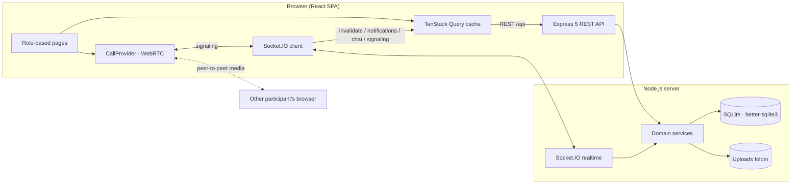
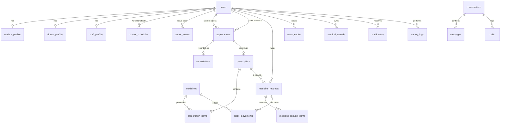
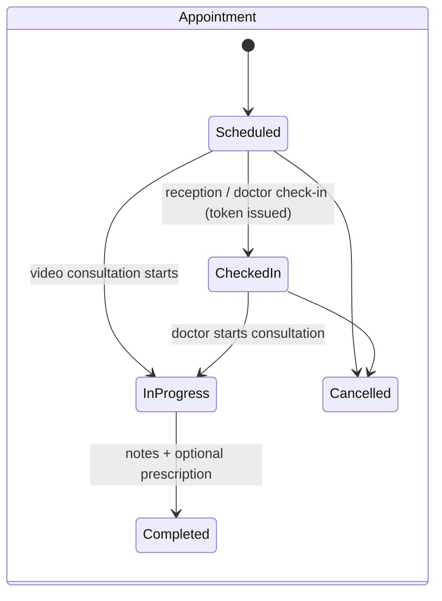
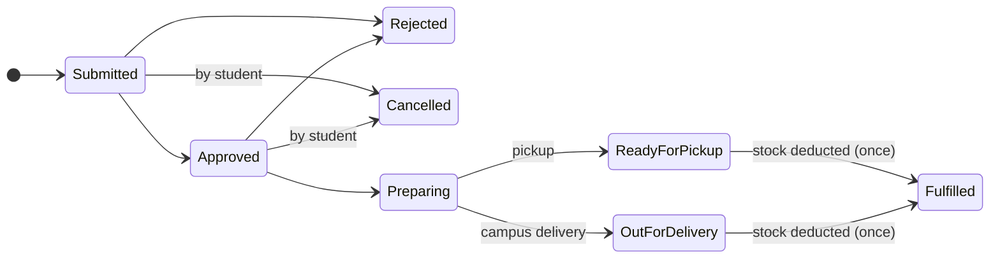

# Smart Dispensary — Architecture

## 1. Overview

Smart Dispensary is a full-stack web application that digitises a campus health centre. Four roles
share one system:

| Role | Primary goals |
|---|---|
| **Student** | Find doctors, book / reschedule / cancel appointments, chat or video-call doctors, view prescriptions and medical records, request medicines (pickup or campus delivery), raise emergency requests |
| **Doctor** | Manage the daily queue, check patients in, run consultations, write prescriptions, review patient history, manage OPD availability |
| **Dispensary staff** | Process medicine requests end-to-end, manage inventory (stock, batches, expiry), respond to emergencies |
| **Admin** | Analytics, user management, oversight of appointments, inventory, requests, emergencies and the activity log |



* **Client**: React 19 + TypeScript + Vite, Tailwind CSS 4 with shadcn/ui (Radix) components, React Router,
  TanStack Query for server state, Recharts for analytics, Socket.IO client for realtime updates, native WebRTC
  for video calls.
* **Server**: Node.js + Express 5 (TypeScript, run with `tsx`), SQLite via better-sqlite3 (synchronous, transactional),
  Socket.IO for push updates/chat/call signaling, zod for validation, bcrypt password hashing, multer for uploads.
* **Shared**: `shared/types.ts` (API DTOs) and `shared/constants.ts` (statuses, labels, workflow transition rules,
  dispensary timetable) are compiled into both client and server so the contract cannot drift.

## 2. Repository layout

```
shared/            Types + constants used by client and server
server/src/
  app.ts           Express app (middleware, routers, static client in production)
  index.ts         HTTP server + Socket.IO bootstrap, auto-seed on first run
  db/              schema.sql, connection, seed data generator, reset script
  middleware/      Bearer-token authentication, role guards
  routes/          One router per resource (REST endpoints)
  services/        Domain logic (appointments, slots, prescriptions, inventory, requests,
                   emergencies, notifications, activity log, dashboards, chat, calls)
  realtime/        Socket.IO: presence, chat typing, WebRTC call signaling
server/tests/      Vitest + supertest API tests, socket tests
client/src/
  components/ui    shadcn/ui primitives (Radix)
  components/app   Design-system building blocks (StatCard, StatusBadge, DataTable, Timeline, QRPass…)
  components/layout App shell (sidebar, top bar, demo role switcher, notification centre, command menu)
  features/<area>  Pages + feature hooks (student, doctors, appointments, consultation, prescriptions,
                   records, medicines, inventory, staff, emergency, admin, chat, calls, notifications, profile)
  lib/             API client, socket client, formatting helpers, query client
e2e/               Playwright end-to-end tests (full presentation flow, video call)
```

## 3. Data model



Key integrity rules enforced **in the database**:

* `uq_appt_doctor_slot` — a partial unique index: one non-cancelled appointment per doctor/date/time.
* `stock_quantity >= 0` and `balance_after >= 0` CHECK constraints — stock can never go negative.
* `uq_dispense_once` — a request can dispense each medicine only once (no double deduction).
* `uq_rx_appointment` — at most one prescription per appointment.

## 4. Workflows (state machines)





Emergency requests: `Submitted → Acknowledged → Responder Assigned → Resolved` (steps may be skipped forward).
The workflow alerts the health-centre team in real time; it never claims automatic ambulance dispatch.

Transition rules live in `shared/constants.ts` (`allowedRequestTransitions`, `allowedEmergencyTransitions`) and are
enforced by the server; the UI only offers valid next steps.

### Appointment conflict prevention
Booking validates: doctor active & accepting, mode offered, date inside the 14-day window, not on leave, the time is a
real slot of the doctor's weekly schedule, not in the past, the slot is free (unique index), the student has no
overlapping appointment with any doctor and no second appointment with the same doctor that day.

### Stock deduction
Fulfilment runs in one SQLite transaction: re-read the request status, verify every item has enough stock, decrement
stock, write a `dispense` ledger row per item (unique per request+medicine), then raise low-stock alerts when an item
crosses its minimum level. Any failure rolls the whole transaction back.

## 5. Realtime & video calls

* Every browser tab opens one authenticated Socket.IO connection and joins the room `user:<id>`.
* After each mutation the server emits `invalidate { keys }`; clients refetch only the affected TanStack Query keys,
  so a booking made by a student appears instantly in the doctor's queue in another window.
* Notifications are persisted and pushed (`notification:new`) for toasts + the bell counter.
* Chat messages are stored in SQLite and pushed (`message:new`, `message:read`, `typing`).
* **Video calls** use WebRTC peer-to-peer media. The server only relays signaling (`call:invite`, `call:accept`,
  `call:signal` offer/answer/ICE, `call:end`), enforces that calls are between a student and a doctor, handles ringing
  timeouts / missed calls, and writes a call log + a chat entry ("Video call · 6m 40s"). No third-party video service
  is used; on the same machine or LAN the browsers connect directly.

## 6. Security model (demo-appropriate)

* Passwords hashed with bcrypt; sessions are random 256-bit bearer tokens stored as SHA-256 hashes with expiry.
* Role-based guards on every endpoint plus ownership checks (students only see their own records; doctors only
  their patients).
* Input validation with zod on every write; uploads restricted by MIME type and size (5 MB).
* Demo mode (on by default) exposes one-click demo identities and a reset endpoint — clearly labelled and
  disable-able with `DEMO_MODE=false`.

## 7. Testing strategy

* **API tests** (Vitest + supertest, in-memory SQLite): authentication, RBAC, booking rules and conflicts,
  consultation → prescription flow, records upload, medicine request lifecycle with exact stock arithmetic,
  duplicate-fulfilment protection, emergencies, notifications, activity log, chat and call signaling over real sockets,
  and seed-data invariants.
* **End-to-end tests** (Playwright, real Chrome): the complete presentation flow across all four roles, plus a
  two-browser video call using Chrome's fake camera.
